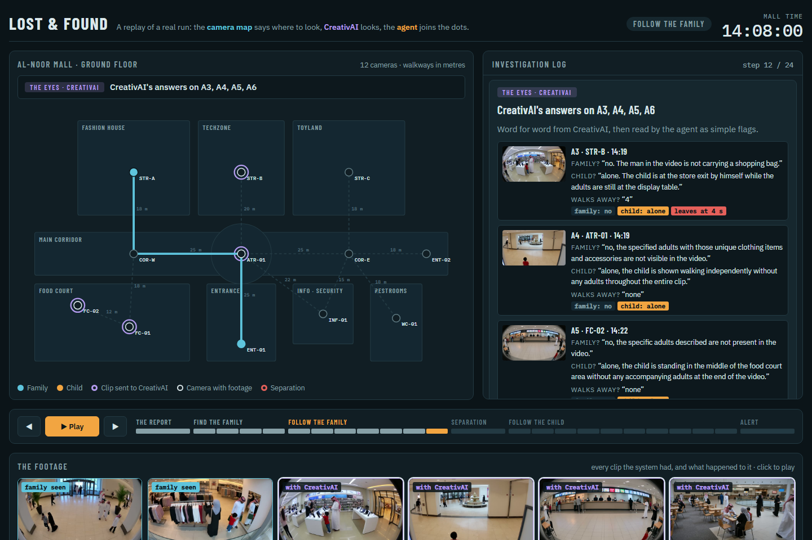
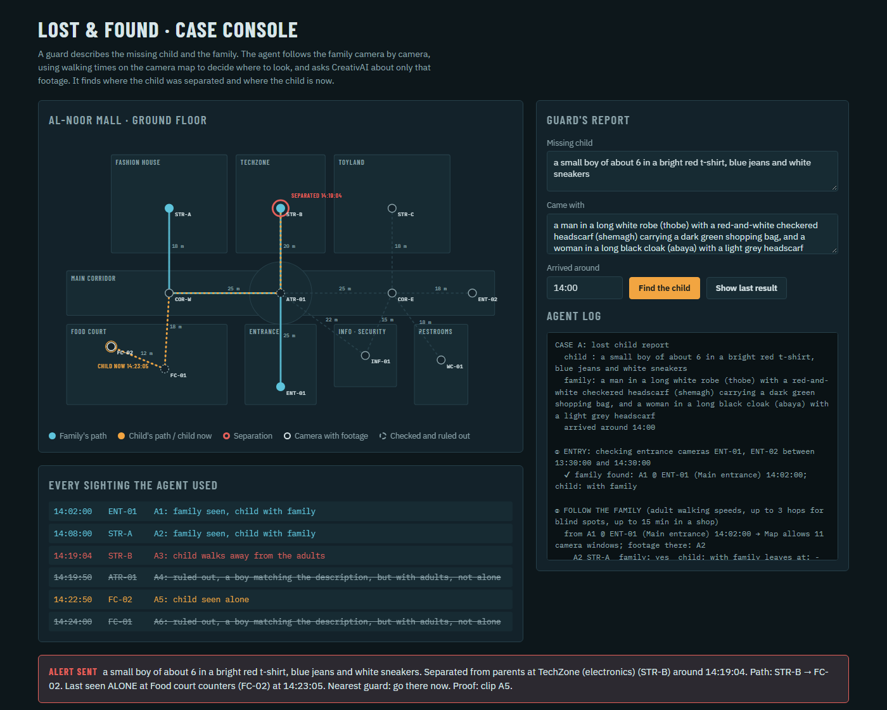

# Lost & Found

**A child goes missing in a mall. A guard types a description of the child and the family. An agent follows the family across the security cameras, finds where the child was separated and where the child is now, and sends an alert with the video as proof.**

### ▶ [Watch the step-by-step replay](https://sahliadem0106.github.io/lost-and-found-ai/)

[](https://sahliadem0106.github.io/lost-and-found-ai/)

The replay is a long, scrolling case study. The ground-floor camera map stays pinned on the left and animates as you scroll. **Part 1** shows what really happened (the family walking in, the boy slipping away in TechZone, his route to the food court, the lookalike family, the parents searching the wrong way). **Part 2** explains the Eyes: how the footage was indexed in CreativAI and the exact questions it is asked. **Part 3** is the agent's real run from the moment the parents reach the security desk: every map calculation, **every prompt sent to CreativAI and every answer, word for word**, and each decision. **Part 4** is the result. It runs in the browser with nothing to install; to run it locally, use `npm start` and open http://localhost:3000/replay.html.

It combines two things:

- **A camera graph (the Map).** This is our own code: no AI, just the mall's cameras, the walkways between them in metres, and how fast adults and children walk. It answers: *"If the family was at camera X at 14:08, which cameras could they reach next, and in which minutes?"*
- **CreativAI's video understanding (the Eyes).** It answers questions in plain English about the footage the Map points to: *"Are these adults in this clip? Is the child with them or alone? At what second does the child walk away?"*

An agent loop joins them: the Map says where to look, the Eyes look, the Map moves forward, and this repeats until the path is complete.

---

## Why

When a child is reported missing, guards scroll through hours of footage from dozens of cameras. Two things make that slow:

1. **They don't know where to look.** Every camera, every minute is a candidate.
2. **Appearance alone is misleading.** In a Gulf mall, many men wear white thobes and many women wear black abayas. A search for "man in a white thobe" matches half the mall.

The camera graph fixes both. People walk along corridors at human speeds, so after one sighting, only a few cameras and a few minutes are physically possible. The system only looks there, which is faster and cheaper, and it rejects lookalikes who are in the wrong place at the wrong time.

## How it works

```
Guard's report:  "Lost boy, about 6, red t-shirt and jeans. Came with a man in a white thobe
                  and red shemagh and a woman in a black abaya with a grey hijab. Arrived ~14:00."
                                          │
① ENTRY        Map: entrance cameras ENT-01, ENT-02 between 13:30 and 14:30
               Eyes: is the family here?                        → A1 @ ENT-01 14:02, boy with them
                                          │
② FOLLOW       Map: from ENT-01 at 14:02, cameras reachable on foot (≤ 3 hops, with time for shopping)
   THE FAMILY  Eyes: family here? child with them?               → A2 @ STR-A 14:08, boy still with them
               Map: from STR-A at 14:08 …
               Eyes: … at STR-B the child walks away 4 s into the clip
                                          │
③ SEPARATION   TechZone (STR-B), 14:19:04
                                          │
④ FOLLOW       Map: from STR-B at 14:19, cameras a child could reach (child walking speeds, ≤ 4 hops)
   THE CHILD   Eyes: is the child here, and alone?               → A5 @ FC-02 14:22:50, alone
               (A6 @ FC-01: a boy in red, but sitting with adults → ruled out)
                                          │
⑤ ACT          Alert: "Separated at TechZone 14:19, last seen ALONE at the food court counters
               14:23. Nearest guard: go there now." + the two clips as proof
```

### The Map (`demo/pipeline/graph.js`)

`demo/mall_topology.json` describes the mall: 12 cameras with positions, the walkways between them with lengths in metres, and walking speeds (adults 0.6–1.8 m/s, children 0.4–1.6 m/s).

From a sighting at camera `c` at time `t`, a neighbour `n` at walking distance `d` can be reached in the window **`[t + d / v_max, t + d / v_min + slack]`**. The slack covers time spent in a shop. To skip cameras that have no footage at that moment (blind spots), the search goes up to 3 hops for adults and 4 for a lost child. Any clip whose camera and time overlap a window is a candidate; everything else is never looked at.

### The Eyes (`demo/pipeline/eyes.js`)

For the candidate clips only, the Eyes:

1. create a **CreativAI data plate** containing just those clips (`/data-plates/create-from-collection` with their media IDs);
2. add three questions as **knowledge-extraction columns** (`/knowledge-extraction/columns/add`), answered by CreativAI for every clip in one call:
   - *Are these adults visible: {family}? Start with yes or no.*
   - *Look for this child: {child}. Start with "with these adults", "alone", "with other adults" or "not present".*
   - *If the child walks away from the adults, at what second? Number only, or "none".*
3. read the answers back, turn them into flags, and **cache** them per clip and question in `demo/pipeline/cache-<collection>.json`. Running the same case again costs nothing and takes under a second.

### The agent (`demo/pipeline/find-child.js`)

It runs steps ①–⑤ above with three rules:

- **Time order.** The family's footage is read in chronological order. The first clip where the described child walks away from adults is the separation, even if a later clip is ambiguous.
- **Lost means alone.** After the separation, only sightings of the child *alone* extend the child's path. A matching boy sitting with adults is logged as ruled out.
- **Physically possible.** Every step is checked against walking speed: a child can't cover 75 m in 20 seconds.

It prints a step-by-step log and saves everything to `demo/results/case-<X>-run.json`, which the case console draws.

### The replay (`demo/replay.html`)

The agent records a structured **trace** of everything it does (`trace` in `demo/results/case-A-run.json`): each Map calculation with its reachable cameras and time windows, each round of questions, CreativAI's answers word for word, and each decision. The replay is a static page that turns that trace into an animated story with a caption per step. It reads only JSON and the web copies of the clips in `demo/media/`, so it works on GitHub Pages. Add `?step=12` to the address to open a specific step, or `?play=1` to start playing straight away.

### The case console (`demo/case.html` + `demo/server.js`)



This is a local web page with no dependencies, for running the agent live. The guard fills in the report and presses **Find the child**. The server runs the agent and streams its log, then the page draws the result on the mall map and cues both proof clips to the right second.

## Results on case A

Case A is a family of three arriving at 14:02. The boy (6, red t-shirt) leaves his parents in an electronics store while they're busy with their phones, and ends up alone at the food court. The footage is 6 clips on 6 cameras, 15 s each, plus a trick clip: a lookalike family with a boy in red eating at the food court.

| | Agent's answer | Truth | |
|---|---|---|---|
| Family arrives | A1 · ENT-01 · 14:02 | A1 | ✅ |
| Family's path | ENT-01 → STR-A → STR-B | ENT-01 → STR-A → STR-B | ✅ |
| **Separation** | **TechZone (STR-B), 14:19:04** | STR-B; the boy walks off ~4 s into clip A3 | ✅ |
| **Child now** | **Food court counters (FC-02), alone** | FC-02 | ✅ |
| Lookalike family (A6) | ruled out: boy with adults | trick clip | ✅ |
| Child's path | STR-B → ATR-01 → FC-02, alone at each | STR-B → ATR-01 → FC-02 | ✅ |

**Every answer is correct.** A full first run takes about 3 minutes and about 27 CreativAI credits (6 clips, 4 rounds of questions). After two clips were remade (see below), only those two were asked about again: 2.5 minutes and 10.8 credits. **Every rerun:** under 1 second and 0 credits, thanks to the cache.

### Honest limits

- **The footage is AI-generated** (Kling via the Higgsfield API), not real CCTV. The clips don't always follow their script either: in A3 the boy leaves at about 4 s, not at the planned 9–13 s, and CreativAI correctly reported 4 s.
- **Two clips had to be remade.** The first A4 had a second, generated boy in a matching red outfit in a tiny-figure dome shot; CreativAI matched him to nearby adults and the agent wrongly ruled the atrium out. The first A5 had a person sprawled on a counter. Both were regenerated with stricter prompts and camera placements that match the map (`demo/prompts/07-remakes.md`) and swapped in with `replace-clip.js`. With the new clips, every answer is correct. The old versions are kept locally as `_v1`.
- **The time-order rule was added after seeing case A's answers.** A blind test on case B (clips generated but never run) was planned to check that the system generalises, and was **not run**. So these results show the method working on one case, not proof that it works in general.
- **Search alone isn't enough.** CreativAI splits video into 16 s chunks, so a 15 s clip is one search hit with no timing, and similarity scores barely differ between similar mall scenes. That's why the Eyes use data-plate questions, not search ranking.

---

## Tutorial

### 1. Replay case A (no keys, nothing to install)

You need **Node.js 18+**.

```bash
git clone https://github.com/sahliadem0106/lost-and-found-ai.git
cd lost-and-found-ai
npm run find:a      # the agent's full log in the terminal (uses cached CreativAI answers)
npm start           # then open http://localhost:3000/replay.html (replay) or http://localhost:3000/?show=last (console)
```

On the console, press **Find the child** to watch the agent run live. With the sample report it uses cached answers, so it finishes instantly. The clips play from `demo/media/case-A/`, which holds light 720p web copies (about 1–1.5 MB each).

If you change the descriptions, the questions change too, so the agent asks CreativAI fresh questions and needs a key (step 2).

### 2. Run it on footage that's already indexed

1. Create a free account at [CreativAI](https://creativ-ai.com) and copy your API key. New accounts get 2,500 credits.
2. Make the key available to Node:
   ```bash
   # macOS / Linux
   export CREATIVAI_API_KEY="your-key"
   # Windows (new terminals)
   setx CREATIVAI_API_KEY "your-key"
   ```
3. Run the agent with any description:
   ```bash
   node demo/pipeline/find-child.js --case A \
     --child "a small boy of about 6 in a bright red t-shirt" \
     --family "a man in a white thobe with a red-and-white shemagh, and a woman in a black abaya with a grey hijab" \
     --arrived 14:00
   ```
   Or give it one sentence with `--report "Lost: …. Came with: …. Arrived: 14:00"`.

> The collection in `state-lost-found-case-a.json` belongs to the original account. With your own key, re-ingest the clips first (step 3).

### 3. Use your own mall and footage

1. **Describe the mall** in `demo/mall_topology.json`:
   - `cameras`: `id`, `name`, `zone` (use `entrance` for entrance cameras) and `pos` in metres;
   - `edges`: walkways `{a, b, dist_m}`;
   - `walking_speed_mps`.

   Check it with `npm run graph -- STR-B 14:19:10 child`, which prints the cameras reachable from STR-B and when.
2. **List the footage** in `demo/pipeline/clips-case-<X>.json`: for each clip, its `file`, `camera` and `start` time (wall clock). Clips are treated as 15 s long; change `t1` in `find-child.js` if yours differ.
3. **Upload and index** to CreativAI:
   ```bash
   node demo/pipeline/ingest.js demo/pipeline/clips-case-X.json          # upload + tag, prints the indexing price
   node demo/pipeline/ingest.js demo/pipeline/clips-case-X.json --index  # actually index
   ```
   Every clip is tagged `camera:<id>` and `clip:<id>`, with `camera`, `start_time` and `start_sec` metadata. Progress is saved to `state-<collection>.json`, so a rerun resumes where it stopped. Indexing six 15 s clips cost about 10 credits.
4. **Run the agent** with `--case X`, and the console with `npm start`. Set `CASE` at the top of the script in `case.html` and `replay.html` to switch cases, and put web copies of the clips in `demo/media/case-X/<id>.mp4` plus a `<id>.jpg` poster (for example: `ffmpeg -i A1.mp4 -vf scale=-2:720 -crf 27 -an -movflags +faststart A1.mp4`).

To **replace a clip** (for example after regenerating it), put the new file in place and run `node demo/pipeline/replace-clip.js demo/pipeline/clips-case-X.json A4`, then `ingest.js … --index` again and rerun the agent. Only the replaced clip is asked about again.

Optional: try raw search with `node demo/pipeline/search.js demo/pipeline/state-<collection>.json "a boy in a red t-shirt" camera:fc-02`.

### 4. (Optional) Generate demo footage

This repo's clips were generated through the **Higgsfield API**. All prompts are in `demo/prompts/`:

1. **Character sheets** (front, side and back of each person on one image) with **Qwen Image 3**, about $0.04 each. These are in `demo/assets/characters/`.
2. **Clips** with **Kling O3 image-reference**, standard mode, sound off: the clip prompt plus the character sheets, so every clip shows the same people. About **$1.07 per 15 s clip**. The two trick clips with strangers used plain **Kling 3.0 text-to-video** at about $0.63.

Total for 7 character sheets and 14 clips: **about $15**.

---

## Repo layout

| Path | What |
|---|---|
| `demo/pipeline/graph.js` | The Map: neighbours, walking-time windows, plausibility |
| `demo/pipeline/eyes.js` | The Eyes: CreativAI data plates + questions, with a cache |
| `demo/pipeline/find-child.js` | The agent: report → entry → family → separation → child → alert |
| `demo/pipeline/ingest.js`, `search.js`, `creativai.js` | Upload/index footage, raw search, small REST client |
| `demo/pipeline/replace-clip.js` | Swap a clip for a new version: removes the old one from CreativAI and forgets its cached answers |
| `demo/pipeline/clips-case-A.json`, `state-*.json`, `cache-*.json` | Case A footage list, CreativAI IDs, cached answers |
| `demo/replay.html`, `index.html` | The animated step-by-step replay (`index.html` sends GitHub Pages visitors to it) |
| `demo/server.js`, `demo/case.html` | The case console |
| `demo/media/case-A/` | Web copies of clips A1–A6 with poster images |
| `demo/results/case-A-run.json` | The agent's result for case A |
| `demo/mall_topology.json` | Cameras, walkways, walking speeds, true story timelines |
| `demo/camera-network.html` | Interactive camera map with the planned story (design-stage page) |
| `demo/prompts/`, `demo/assets/characters/` | Generation prompts and character sheets |
| `PROJECT.md` | Full project plan and session-by-session notes |
| `concepts/`, `IDEAS.md` | The brainstorm that led here |

## Built with

- **[CreativAI](https://creativ-ai.com)** video intelligence API: collections, chunk indexing, tags and metadata, data plates, knowledge extraction, search.
- **[Higgsfield](https://higgsfield.ai)** API for generating the footage: Qwen Image 3, Kling O3, Kling 3.0.
- **Node.js** (no npm dependencies), plain HTML/SVG for the console, and ffmpeg for checking frames.

## Privacy by design

The system searches only when a case is open, and only the footage the camera graph points to. It works on clothing descriptions, not faces, and keeps no face database. In a real deployment, case data would be deleted when the case closes.
